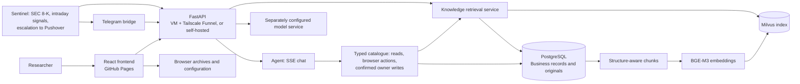

# FinBot

[中文](README.md) | [English](README.en.md)

**Demo:** [Open the research workspace](https://wp1461772181-glitch.github.io/FinBot/) · **Repository:** [wp1461772181-glitch/FinBot](https://github.com/wp1461772181-glitch/FinBot)

FinBot is a **personal finance assistant** for individuals who research US stocks. It sits on top of an evidence workbench: saved market data, SEC filings, research materials and versioned analyses, with Agent chat bounded by saved evidence. On top of that it knows *your* situation — your portfolio and available cash, the companies you follow, the routines you set — answers you on Telegram, and alerts you when earnings land or a position moves sharply.

The product focuses on an inspectable process, traceable evidence, and conclusions that can be revised when new material arrives. It does not promise accurate stock forecasts and is neither a trading system nor a live-quote service. See the [before/after report](docs/reports/2026-11-personal-finance-before-after.md) for what has been measured and what still awaits measurement.

## Personal finance assistant (released 2026-11)

Everything below is deployed. The [before/after report](docs/reports/2026-11-personal-finance-before-after.md) states, item by item, what was measured, how, and what is still pending (real devices, real earnings days, forecast expiry).

- **Multiple bots.** Create several bots, each with its own name, avatar (animated bloub avatars with customisable shape, expression and colour), followed companies, model and tool scope; each bot has one continuous conversation. Switching bots keeps your draft and does not interrupt an answer in progress; messages written by other channels (e.g. Telegram) appear in the web view within seconds.
- **Portfolio.** Enter positions by hand or by chat (through a confirmation card); the assistant computes cost, P&L, total assets and available cash. A missing price is never guessed — total assets become unknown with a warning — and a sale larger than the holding is refused before any card appears. Portfolio answers carry their sources.
- **Routines and memory.** Scheduled routines created through a confirmation card (hourly, daily or weekdays, optionally per symbol, Asia/Shanghai time); a user profile; saveable skills (the card offers “save and enable” or “save as draft”).
- **Telegram channel.** Each bot can be bound to Telegram. The bridge shows “typing” continuously, replies with a placeholder first and edits it as steps arrive, queues turns for the same bot and runs different bots in parallel. `/压缩` (compact) works on both web and Telegram.
- **Earnings monitoring and alerts.** A separate sentinel process watches SEC 8-Ks (Item 2.02 only), polling about every two minutes inside the earnings window. On detection it sends a first message comparing the release with the prior guidance; about 30 minutes later, if the judgment is not “unclear” and confidence clears the bar, it sends a follow-up with quote-backed reasons. Held companies are pushed; research-queue companies are only recorded in the conversation. If the API has not accepted the event within two minutes, the sentinel itself sends “earnings are out; analysis temporarily unavailable”. **Until the earnings-judgment model has passed the full blind test, follow-ups are labelled “this model has not been blind-tested”.**
- **Intraday moves and escalation.** Short-window, intraday and gap signals scaled to each stock's own volatility. Alerts carry an “acknowledge” button; a falling-position alert unacknowledged for a minute can escalate to Pushover emergency priority, and at night only two kinds ring (the rest are summarised at 08:00). A real Pushover ring has not yet been tested.
- **Reasoning-model forecasts.** With a model chosen under “Forecast model” in settings (`FORECAST_DECISION_MODE=llm`), the primary forecast comes from that model (`experimental_llm`), while Jev runs on the same input as a hidden control; the expiry-evaluation page shows the two groups separately. Forecast scores need 20 trading days to mature and there are none yet.
- **Progressive tool disclosure.** A turn carries only 8 always-on tools by default (about 6.8 KB of definitions, down from 36 tools / about 27.3 KB); the rest join by category through `load_tools` or intent preloading. Write tools still need authorization and a confirmation card.
- **Rolling context compaction.** The history budget follows the selected model's context window (50% of it). At 80% usage, old turns are merged in the background into one structured rolling summary (goals, conclusions, open items, preferences, key figures); every conclusion and figure must carry a `{turn_id, ordinal}` source marker or the whole summary is rejected, and a model failure keeps the old summary. The conversation shows an expandable “N turns compacted”, and `recall_conversations` can look up the same bot's original messages.
- **Annotate, don't delete.** A sentence whose sources do not check out stays in the answer with an “insufficient evidence” badge and a follow-up shortcut; a number found in no source is badged “number unverified”.

## Agent chat

- Full-page SSE chat streams status, tool calls, results, and answers, with readable badges for tool activity.
- The production LangGraph entry point now uses four direct routes: A retrieves evidence before the tool loop, B answers in-scope concepts without tools, C returns a fixed out-of-scope response, and D enters the tool loop directly. Structured model function calls select the route and typed read tools. Reference resolution is a separate model call followed by scope validation; the first standalone question skips it. A and D share typed read, queue/navigation and confirmed owner-write tools.
- Long conversations use three context layers: recent turns word for word, half-compressed history (your words and the start of each answer), and a structured rolling summary, sharing one budget that follows the selected model's context window (50% of it at 3 bytes per token, at least 16 KB, no fixed cap; 192 KB for the default 128k window). Usage at 80% triggers background compaction; `/压缩 [focus]` or the card's button compacts on demand. In the current direct graph, a bounded recent-dialogue slice is supplied as reference context; prior messages are not evidence or a ground for a citation. A summary is memory, not evidence. The “Context left” pill beside the model picker shows each part.
- Costly writes require an owner confirmation card with frozen arguments, an expiring conversation-bound capability, and durable replay protection. Guests receive browser-local queue and navigation actions. Confirmed web ingestion remains private and retains `web_news` provenance through indexing and retrieval.
- `web_research` can search public pages through Tavily or read a public HTTPS URL. Search defaults to a separately configured server-side `TAVILY_API_KEY`; without it, search reports unavailable and never silently falls back to Bing. Public URL reads do not need a Tavily key. Page excerpts are bounded and search snippets are not treated as page bodies.
- Answers support Markdown, tables, source citations, and quoted excerpts. Users can copy answers, navigate to questions, and inspect cited sources.
- Conversations and tool traces are stored server-side by identity, with guest and personal identities separated. Users can export a local JSON conversation archive as a backup.

## Thinking process

Every answer carries a “Thought for N s · M steps” panel. While a turn runs, the graph grows in place: input, reference resolution, routing, model decisions, tool calls, evidence verification, repair, and the final answer. Parallel tools fork from the decision that called them and join at the next step; each node shows its status and duration and can be expanded for a short output summary or its raw data. The panel folds after completion; a manual toggle lasts for the current page. After a refresh, it starts folded again but the graph and total time replay from the server, and a cancelled turn never leaves a running node behind.

This is an execution trace, not the model's chain of thought: it records what the system actually did, which tools it used, and how long each step took, without exposing hidden reasoning. Traces are capped at 60 nodes, each output is compressed to 400 characters, and the active model API key is redacted to `[redacted]`; confirmation-card control values never enter the trace. A trace is not added to the model context. See the [dialogue design notes](docs/agent-dialogue-engineering.zh-CN.md) for the measurements.

| Tool | Purpose |
| --- | --- |
| `query_stock_prices` | Read saved daily OHLCV and fetch time; these are not live quotes. |
| `query_latest_forecast` | Read the current research forecast version, status, time, and summary for a stock. |
| `query_materials` | Search saved SEC filing excerpts and user uploads; it does not search FAQs. |
| `query_sec_filings` | Read the saved SEC filing inventory and fetched excerpts; it does not contact SEC. |
| `query_research_faq` | Search the approved research FAQ. |
| `query_material_analysis` | Read the latest saved AI analysis and its source link for a material. |
| `search_material_analysis` | Search saved AI analyses, which are derived materials. |

## Try it

1. Open the [online demo](https://wp1461772181-glitch.github.io/FinBot/). Visitors can browse; write operations require a personal identity.
2. In Model settings, enter a profile display name, endpoint, model ID, and your own model key. Run the connection test and save the profile. Select it in the chat composer to use it. See the [model profile and storage guide](docs/model-profile-storage.md).
3. Ask about an original quote in saved materials, or about supporting evidence, counter evidence, and key numbers in a saved AMD analysis. Then inspect the cited source.

Visitors do not receive administrator access, and the demo server does not provide shared model keys.

## Model settings and local conversation archives

- Choose a preset model or a custom HTTPS endpoint, then enter a model ID and display name. The UI supports connection checks, saved profile cards, and profile selection in the chat composer.
- Services that support model discovery can return up to five suggestions. The provider catalog includes DeepSeek, Kimi, MiniMax, Qwen, Zhipu, Doubao, Hunyuan, Baidu, SiliconFlow, OpenRouter, and custom endpoints. Discovery depends on the service.
- Browser credentials use OPFS/IndexedDB. A separately configured local server-file mode is also available for local deployments. The browser does not treat arbitrary plaintext project files as its credential store; this does not imply encryption at rest.
- Chat history does not store provider API keys. Automatic archiving depends on browser support, and the archive file must be selected again after reload. Archives are local conversation records, not an evidence store; see the [conversation archive guide](docs/chat-local-files.md).

## Research materials and retrieval

The material library manages approved FAQs, fetched SEC filing excerpts, and user-uploaded TXT, Markdown, and PDF files (without OCR). The backend provides upload/import, retrieval testing, and index status. PostgreSQL stores originals, chunks, jobs, and analysis versions; Milvus stores the vector index. BGE-M3 produces dense vectors. The online demo currently uses hybrid retrieval, fusing dense results and BM25 with RRF. `bge-reranker-v2-m3` reranking can be enabled through configuration.

Parsing retains document structure and table headers. Retrieval applies owner, stock, time, and version filters, and supports idempotent retries, reindexing, and citations to exact sources.

### Saved analyses become knowledge

Saved AI analyses can be added to knowledge retrieval in six groups: summary, facts, supporting inferences, counter inferences, key numbers, and uncertainties. Analyses retain versions, model information, and original quotes; indexed results follow public/private visibility and owner isolation. These are AI analyses derived from source material, not independently verified facts.

Public validation so far includes two saved AMD analyses that produced 66 chunks, followed by successful indexing, querying, and citation readbacks. This verifies the workflow; it does not mean all historical materials have been backfilled or every question will retrieve accurately. Conversation review and extraction are separate optional operations; the system does not automatically learn from every chat.

## Research workspace

- **Watchlist and overview:** Users can maintain a list of US stock symbols; seven example stocks are provided by default. Stock pages organize prices, materials, forecasts, and evaluation by symbol.
- **Prices and benchmark:** View saved OHLCV and SPY comparison candlesticks with data dates and fetch times. Historical snapshots can be read with time boundaries.
- **SEC filings:** Store filing inventories, source links, and fetched excerpts; scanning can be started from the materials workflow. The Agent's read tools only read saved records; fetching filing text is a write action that runs only after a personal identity confirms it.
- **Material analysis:** Generate and cache AI analyses with versions, original quotes, and citation navigation. Reopening a saved analysis does not call a model again.
- **Research workflow:** Reusable material analyses can produce a ResearchBrief, which can then be evaluated by the experimental Jev three-class decision model as bullish, neutral, or bearish. Jev consumes a research brief; it does not generate one. Fixed targets and expiry assessments are retained with immutable versions.
- **Evaluation and run status:** Inspect expiry assessments, historical replay, background queues, and monitoring status. A four-strategy Recall@K/MRR evaluation harness exists; synthetic results do not represent production accuracy.
- **News leads:** Saved news leads and public web retrieval in chat are separate read-only paths; chat does not automatically save webpages as research materials. Recent queries require readable publication dates; explicit `days_back` windows (1–366 days) are clipped precisely, while an unbounded “recent” request uses seven days.

Jev forecasts retain the original probabilities. A local calibration pipeline uses matured observed samples and enables a candidate only after chronological holdout validation; historical calibration research is kept separate from live samples. Outputs remain experimental research results, not forward-validated investment success rates.

## Architecture

PostgreSQL stores business records, originals, chunks, jobs, and conversations; Milvus stores the retrieval index. Originals and vector indexes are updated separately, not as one atomic dual-write. Model services are configured separately from the business database. The public demo frontend is hosted on GitHub Pages. The backend API, Telegram bridge and sentinel run as systemd units on a maintainer-operated VM (see [`deployment/muse/`](deployment/muse/)) against a Supabase PostgreSQL database, exposed through Tailscale Funnel; the knowledge-retrieval service runs on a separate machine reached through a tunnel. That VM has been replaced by its platform several times, causing whole-stack outages; a one-shot recovery script and a watchdog exist, but availability is not guaranteed. Local self-hosting is also supported by the setup documentation.

## Current boundaries

The Agent's read tools only read saved records; explicit web research can read bounded excerpts from public pages, and error or navigation pages are detected and skipped. It does not trade or retrieve live prices. Page/API write actions have their existing identity checks. Chat writes require explicit user intent and server confirmation; public pages may be ingested as `web_news` without becoming official evidence. See the [verification report](docs/reports/agent-routing-verification.md) for the exact deployed revisions, DeepSeek-Flash results and release checks dated 2026-10-16. “Context left” is this product's context budget, not the window of the model you chose. Evidence gating uses heuristics, answers can still be wrong, and citations do not prove every answer is faithful.

The earnings-judgment model has not passed the full blind test, forecast scores need 20 trading days to mature, and real-device checks (Telegram latency, Pushover ring, a real earnings day) are still pending; none of these outputs is investment advice. Forecasts, material analyses, and retrieval results require researcher review against original sources and timestamps. Forecast evaluation is meaningful only for matured samples with available outcomes; historical replay and synthetic retrieval metrics do not establish future performance. High-concurrency guarantees and end-to-end atomic writes remain unverified. The verification report records the latest official DeepSeek-Flash evaluation and real public guest checks, including earlier failed runs. Real owner-write production coverage remains unverified.

## Documentation

- [Local setup and deployment](docs/github-pages-local-backend.md)
- [Conversation archive files](docs/chat-local-files.md)
- [Model profiles and storage](docs/model-profile-storage.md) · [Model discovery](docs/model-discovery.md)
- [Conversation context and the retention evaluation](docs/agent-context.md) · [Evaluation report](docs/context-retention-report.md)
- [Dialogue system design and thinking-process measurements (Chinese)](docs/agent-dialogue-engineering.zh-CN.md)
- [Before/after report for the personal-finance release](docs/reports/2026-11-personal-finance-before-after.md) · [Earnings blind-test (smoke) report](docs/reports/2026-11-earnings-blind-test.md)
- [Knowledge retrieval](docs/knowledge-rag.md) · [Four-strategy evaluation report](docs/knowledge-rag-ch34-reports/four-strategy-evaluation.md)
- [Custom stock support](docs/custom-stock-support.md) · [Experimental forecast and learning limits](docs/jev-local-learning.md)

## Future direction

Pending rather than scheduled: moving the backend to a dedicated server and then running one unified acceptance pass on real devices (guest and owner questions, Telegram, Pushover, a real earnings day), the full blind test of the earnings-judgment model, and the first mature forecast scores. The system does not implement multi-Agent autonomy or model fine-tuning.

## Release notes

- **2026-11-01 – 11-03 (personal finance assistant).** Bot switching without losing drafts (`db10065`); saving skills (`2fc6424`); price precision (`9b83e91`); Supabase migration and VM deployment (`16109a7`–`5487e40`); sentinel (`e025e4e`); portfolio v1 (`5a84b26`); annotate-don't-delete answer gate (`905d86f`); earnings reader and blind-test script (`6f7d710`); Telegram feedback, intraday alerts and escalation (`f105f1c`, `badb3a5`, `0b04d3f`); earnings monitoring (`e70824e`, `e424e96`); progressive tool disclosure (`d947061`, `09d3c8f`); reasoning-model forecasts (`3197917`, `f53b4c0`); rolling context compaction (`2e9050b`, `3b6dfb8`, `58b33f8`). Per-item numbers and what remains unmeasured: [before/after report](docs/reports/2026-11-personal-finance-before-after.md).
- Earlier releases: see the [routing verification report](docs/reports/agent-routing-verification.md) and the release list in the Chinese [README](README.md).

## 🧭 Routing verification

The [C1–C14 verification report](docs/reports/agent-routing-verification.md) links the 50-case JSONL evaluation, permissions, test migration, and release status. The public demo may run a different revision.
