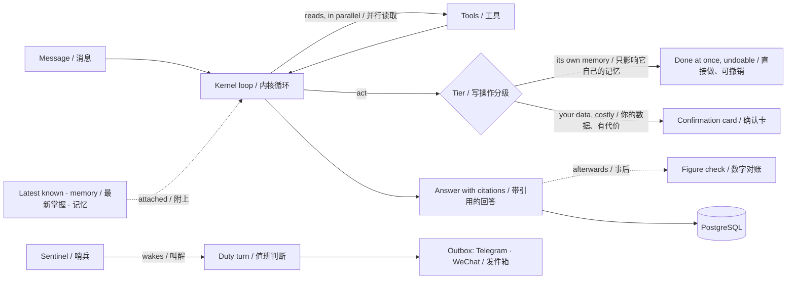

<div align="center">


# 📈 FinBot

### 你的个人金融助手：先找证据，再形成判断。
### Your personal finance assistant: evidence first, decisions you can revisit.

**多个专属 bot、持仓与例行任务、Telegram 随身提问、财报与盘中异动提醒，全都建立在一条可核验、可回放、可修订的研究链上。**
**Several dedicated bots, your portfolio and routines, Telegram on the go, earnings and intraday alerts — all built on a research trail you can verify, revisit and revise.**

[🚀 试用演示 / Try the demo](https://wp1461772181-glitch.github.io/FinBot/) · [📦 源码 / Source](https://github.com/wp1461772181-glitch/FinBot) · [🧭 中文](#中文) · [🇬🇧 English](#english)

[](https://github.com/wp1461772181-glitch/FinBot/actions/workflows/ci.yml)


</div>

> **演示说明 / Demo note** — GitHub Pages 提供前端；数据与 API 依赖维护者侧的独立后端。后端环境会影响演示可用性。  
> GitHub Pages serves the frontend; data and API actions depend on a separate maintainer-hosted backend, which affects demo availability.

## ✨ 为什么值得用 / Why it matters

- **个人金融助手 / A personal assistant, not just a workbench** — 你可以建多个各有关注点、模型与工具范围的 bot；录入持仓后它能回答「今天赚了多少」「补仓要多少钱」；例行任务按时汇报；财报与盘中异动经 Telegram 和微信（可选 Pushover）主动提醒。
- **它替你盯着 / It keeps watch for you** — 盯盘规则只负责叫醒它：它查原因，再判断要不要马上告诉你；夜里压住的提醒留到早 8 点，由它写进简报；每天收盘后它会自查有没有漏报。
- **证据先于结论 / Evidence before answers** — 回答绑定已保存的行情、SEC 文件、研究材料和引用坐标；公开网页研究是独立的只读能力，不会自动混入已核验材料。
- **判断可以回放 / Decisions you can replay** — 预测版本不可变并绑定固定目标；材料分析汇总为 `ResearchBrief`，记录来源版本与决策时点，后来新增了什么、判断如何变化都能回看。
- **模型可以替换 / Your model, your key** — 材料分析支持 11 种 OpenAI-compatible 模型服务配置（含自定义端点）；后台可设全局默认，单次任务可覆盖，API key 加密存储并在任务进入终态后清除。
- **引用经得起核对 / Citations you can check** — 引用按 exact → normalized → fuzzy 分层定位；仍定位不到时保留结论并明确标注「引用待核对」，而不是让整份分析失败。
- **一条研究闭环 / One research loop** — 材料采集 → 证据入库 → AI 分析（可配置模型）→ 引用核验 → ResearchBrief → 预测版本 → 修订候选 → 复盘。
- **它边做边说 / It tells you what it is doing** — 每一轮它用自己的话说正在做什么；复杂的任务先列清单，做完一项打一个勾。它工作时你可以插话：它会决定把你的话并进当前这件事、另起一件，还是停下。

> **2026-11-28 新内核 / New kernel** — 对话换成了新内核：一条只追加的工具循环，不再预先分类，也不在回答后改写。它自己决定想多深，边做边说，可以插话、可以交办；系统里能操作的它都能做，改你数据的操作要你点确认。同期上线的还有：
> - 公司档案和「最新掌握」；
> - 记忆：你的看法、当场记、每月整理；
> - 后台值班和早间简报，每天的漏报自查；
> - 财报日历和市场一致预期；
> - 后台各栏。
>
> 旧流水线已经删除。评测题集 86/86 全过（旧流程基线 83/86），整轮中位约 5 秒（旧流程 11.5 秒）。设计见[新内核方案](docs/finbot-new-kernel-plan-2026-11-22.zh-CN.md)，各阶段的报告在 [docs/reports/](docs/reports/)。
>
> The 2026-11-28 release replaces the conversation pipeline with a new kernel: one append-only tool loop, with no pre-classification and no post-answer rewrite. It chooses how hard to think, says what it is doing as it works, accepts interjections and can hand work off. Anything the system can do, it can do; writes to your data wait for your confirmation. Also live:
> - company files and the "latest known" block;
> - memory: your views, writing things down as they come up, a monthly consolidation;
> - background duty with a morning brief, and a daily missed-alert check;
> - the earnings calendar with consensus estimates;
> - the backstage pages.
>
> The old pipeline is removed. The evaluation suite passes 86/86 (old baseline: 83/86), with a median turn of about 5 s (old: 11.5 s). See the [kernel plan (Chinese)](docs/finbot-new-kernel-plan-2026-11-22.zh-CN.md) and the per-stage reports in [docs/reports/](docs/reports/).

> **2026-11 发布 / Earlier in November** — FinBot 从「研究证据工作台」扩展为**个人金融助手**：多 bot、持仓、例行任务、Telegram 通道、财报监控与提醒、推理模型预测（以 naive-vol-v1 为免费基准）、工具渐进披露、上下文滚动压缩。逐项前后数据与**尚待实测**的清单见[前后对比报告](docs/reports/2026-11-personal-finance-before-after.md)；真人真机验收尚未统一执行，README 只写已上线且可核验的内容。
>
> The 2026-11 release extends FinBot from a research evidence workbench into a **personal finance assistant**: multiple bots, portfolio, routines, a Telegram channel, earnings monitoring and alerts, reasoning-model forecasts (scored against the free `naive-vol-v1` baseline), progressive tool disclosure and rolling context compaction. Per-item before/after numbers — and the list of metrics that still await measurement — are in the [before/after report](docs/reports/2026-11-personal-finance-before-after.md). Human, on-device acceptance has not yet been run as a whole; this README only states what is deployed and verifiable.

> **2026-10-22 发布 / Previous release** — 在 2026-10-20 的可配置分析与分层引用核验之上，本次加入 **可查看的思考过程**：
>
> 每轮回答显示总耗时与步骤图，指代消解、意图识别、工具调用、证据核验和修复各有状态与耗时；刷新可回放，取消后会正确收尾。步骤图最多 60 个节点，不含 API key 或确认卡控制值，也不增加对话上下文计费。
>
> The 2026-10-22 release builds on the 2026-10-20 configurable-analysis and layered-citation work with an **inspectable thinking process**: every answer shows its elapsed time and a step graph covering reference resolution, routing, tool calls, evidence checks and repairs, with replay after refresh and clean cancellation. The graph is capped at 60 nodes, omits API keys and confirmation values, and does not increase the conversation-context bill.

## 🧭 工作流 / Shared workflow



---

# 中文

<a id="中文"></a>

## 🌱 项目简介

FinBot 是一个**个人金融助手**，面向自己研究美股的个人投资者。它建立在一个**证据工作台**之上：公开资料、已保存行情、SEC 文件、研究材料和 AI 分析在同一条可追溯链路上——你可以用自然语言提问，查看每条结论引用了哪段原文，保存不可变的预测版本，并在新材料出现时看到哪些内容可以修订、为什么。

在此之上，助手还认识**你自己的情况**：你的持仓与可用资金、你关注的公司、你设定的例行任务；它能在 Telegram 里随时回答，并在财报发布、盘中异动时主动提醒你。它不是只给答案的聊天框，而是让判断过程更容易回看：**当时看到了什么、依据来自哪里、后来新增了什么、判断如何变化。**

## 💬 可以这样问

- “查一下 AAPL 最近保存的 SEC 文件有哪些？”
- “这份 10-K 对收入风险说了什么？请给我原文出处。”
- “搜索近期关于 NVIDIA 的产品新闻，并列出发布日期和来源。”
- “总结我保存的 MSFT 材料里，对现金流的不同说法。”
- “把这份 10-Q 用 OpenRouter 的 GPT-4o-mini 重新分析，并标出无法逐字定位的引用。”
- “这次预测之后有哪些新材料可以修订？为什么这份 30 天内的材料之前没用到？”
- “解释看跌、中性、看涨三类概率分别表示什么。”
- “我买了 100 股 INTC，成本 80。”（弹出确认卡，确认后记入持仓）→ “今天赚了多少？”“补 50 股要多少钱，可用资金够不够？”
- “每个交易日早上给我一份持仓公司的新闻摘要。”（由确认卡建立例行任务）
- “/压缩 重点保留 Intel 的分析”（手动压缩当前对话，见下文）

公开网页研究是独立的只读能力，网页结果不会自动导入已保存材料；用户明确要求保存后，可由所有者确认入库。最近新闻检索会要求可解析的发布日期；显式时间跨度由 `days_back`（1–366 天）精确裁剪，未注明跨度的“最近”按近 7 天筛选。写操作会先显示操作与目标，等待确认。

## ✨ 能力一览

### 对话内核（2026-11-28）

每条消息都进同一个只追加的工具循环：不预先分类，也不在回答后改写。
- **想多深由它定。** 每轮从低档起步，觉得难再自己升档。
- **查得快。** 同一步要查的几样资料并行去查。
- **看得见。** 它边做边用自己的话说在做什么；判为高档的任务先列清单，做完一项打一个勾。
- **可以插话。** 它工作时你发的消息，它逐条决定：并进当前这件事、另起一件，还是停下。
- **可以交办。** 跑腿的查询可以派给小助手（默认关），判断和结论它自己写。
- **出错不整轮失败。** 模型出错时换成备用模型，并在回答末尾写明。
- **知道最新情况。** 提到关注的公司时，系统自动附上「最新掌握」：最近的财报摘要、财报日历、公告和行情，每条都带时间和新旧，能直接引用。

系统里能操作的它都能做：一个 `act` 工具对应四十多个操作，分三级。
- 只影响它自己的记忆和关注列表的，直接做，可以撤销；
- 改你数据的、有代价的，出确认卡，你点了才执行；
- 定时任务里提出的，一律进收件箱「待你确认」。

密钥和凭证它不代填。

### 个人金融助手（2026-11 上线）

以下能力均已部署；逐项状态（哪些已实测、哪些待真机/待到期）见[前后对比报告](docs/reports/2026-11-personal-finance-before-after.md)。

- **多 bot**：可创建多个 bot，各自有名称、头像（bloub 动画头像，可定制形状/表情/颜色）、关注公司、模型与工具范围；每个 bot 一条持续的对话线。切换 bot 不丢草稿、不中断正在生成的回答；其他渠道（如 Telegram）写入的新消息会在网页端数秒内出现。
- **持仓**：网页手填或对话录入（经确认卡），计算成本、盈亏、总资产与可用资金；缺价格时不估算，总资产标为未知并给出警告；卖出超过持仓会在确认前被拒。持仓问答的数字附来源。
- **例行任务**：经确认卡创建的定时例行任务（每小时 / 每天 / 每个交易日，可指定股票，默认东八区时间），每次运行由它按说明做完。它提出的操作进收件箱「待你确认」；有值得马上说的，它会发消息告诉你。另有可保存的技能（确认卡可选「保存并启用 / 存为草稿」）。
- **记忆**：你说的偏好和看法，它当场记下并告诉你，可以撤销；每一次变更都能在后台看到。画像每月整理一次，长期记忆每季沉淀一次。「它眼中的你」可以查看，也可以改。
- **消息通道**：Telegram 和微信并成一层，主动消息按你设的通道偏好发出，一个通道发不出去会转另一个。Telegram 桥会持续显示「正在输入」，先回占位消息，再随着步骤编辑；同一个 bot 的消息排队，不同 bot 并行。网页和 Telegram 都支持 `/压缩`。
- **财报监控与提醒**：独立的哨兵进程监控 SEC 8-K（仅 Item 2.02），财报窗口内约每 2 分钟轮询；发现后第一条给出对上季指引的对比，约 30 分钟后在判断不为 unclear 且把握达标时追加一条带原文理由的判断。持仓公司推送，研究队列公司只记入对话；哨兵若 2 分钟内没有被 API 接收，会直发「财报已出，分析暂时不可用」。**财报判断模型未经全量盲测前，追加提醒会注明「该模型未经盲测」。** 另外接了 Finnhub 的财报日历和市场一致预期：
  - 问到一家公司时，自动带上它下次财报的日期；
  - 财报前一晚，发一份「财报前瞻」；
  - 财报出来后，第一条消息写明实际比预期高还是低。比较按原文的精度来，口径不同时会注明。
- **盯盘值班**：哨兵按个股自身的波动把异动分成「值得知道」和「重大」两级；你也可以用一句话定自己的规则。每条提醒都会叫醒它：它先查原因，再决定马上告诉你、攒进简报，还是只记下来，理由都留在后台的「值班」栏。夜里 0–8 点，除了会响铃的，其余都先压住，早 8 点由它写进简报一起说明。每天收盘后，它自查有没有漏报。
- **盘中异动与升级提醒**：按个股自身波动率判断的短时/日内/跳空信号；提醒带「收到」按钮，持仓下跌类提醒 1 分钟未确认可升级到 Pushover 紧急级，夜间只响两类（其余早 8 点汇总）。真实 Pushover 响铃尚未实测。
- **预测改用推理模型**：设置页「预测模型」选定后（`FORECAST_DECISION_MODE=llm`），主预测由所配模型给出（`experimental_llm`）。每个到期版本都与免费基准 `naive-vol-v1`（按 20 日波动率读时计算，不入库）比较，跨公司的模型成绩页按模型分组、满 30 个独立预测才给结论。预测成绩需 20 个交易日到期，尚无结论。Jev 不再参与预测，早期 Jev 预测仍可查看并保留评分。
- **后台**：回答、用量、操作、投递、值班、记忆变更、质量，共七栏，全部只读。每个回答都可以点「好」或「不好」；每周自检会把被点「不好」的回答归类。
- **上下文滚动压缩**：历史预算跟所选模型的上下文窗口走（窗口的 50%）；用量达 80% 自动、在后台把旧轮次合并进一份结构化滚动摘要（目标 / 结论 / 未办完 / 偏好 / 关键数字），结论与数字必须带 `{turn_id, ordinal}` 来源标记，缺来源的整份拒收，模型失败时旧摘要不丢；对话里显示可展开的「已压缩 N 轮」；`recall_conversations` 可回查同一 bot 的原文。
- **回答后核对数字，只标注**：回答发出后，后台再把里面的数字和本轮的资料对一遍。对不上的数字只在对话的「来源」页和后台标出来，回答本身不删、不改。

### 数据与网页研究

类型化的已保存数据读取工具覆盖价格历史、最新已保存预测、SEC 文件、材料、材料分析和研究 FAQ；`web_research` 是独立的只读能力。公开网页发现使用 Tavily，也可读取用户提供的 HTTPS 页面，并限制请求大小、跳转次数与摘录长度。网页摘录可能不完整或过时，不会自动变成已保存或已核验材料。

### 确认写操作与对话上下文

Agent 可提出写操作：只有所有者确认冻结目标的卡片后才执行，令牌绑定当前对话、10 分钟有效并防止重复执行。游客的队列和页面动作仅作用于当前浏览器。网页可经确认保存为 `web_news`，检索时持续标注网页来源。对话上下文分三层：近期轮次保留原文，较早轮次部分压缩，更早内容并入结构化滚动摘要。历史预算按所选模型的上下文窗口计算（窗口的 50%，按每 token 3 字节换算，下限 16 KB，无固定上限；默认窗口 128k 时为 192 KB），用量到 80% 自动压缩，也可输入 `/压缩 [重点]` 手动触发。摘要是记忆而非证据，回答依据来自本轮工具结果。

### 边做边说和清单

新内核每一轮都用自己的话说正在做什么：每次调用工具可以附一句；没写时，系统补一句平实的话；一步超过 10 秒，系统会说明在等什么。判为高档的任务先列清单，由系统替它打勾。网页、Telegram、微信上都能看到。新内核之前留下的旧对话，仍按原样回放当时的步骤图。

### 可配置 AI 材料分析

材料分析任务可以选择 **DeepSeek、Kimi、MiniMax、通义千问、智谱 GLM、豆包、腾讯混元、百度千帆、SiliconFlow、OpenRouter**，或自定义 OpenAI-compatible 端点。后台可设置全局默认；单次任务可以覆盖。每个任务会冻结自己使用的 provider、base URL 和 model，API key 加密存储，任务进入终态后清除。管理员可在 Agent 管理页设置默认模型，普通用户也可以在单次分析时选择“系统默认”或已保存的模型配置。

### 引用核验：精确、规范化、近似、待核对

每条引用先尝试 **exact** 逐字匹配；再尝试 **normalized**（全半角、引号、破折号、空白和零宽字符归一化）；再尝试 **fuzzy** 近似匹配（相似度阈值、长度差限制、最佳与次佳匹配差距）。仍无法定位时标记为 **unverified**：保留结论、标注「引用待核对」，不会让整份分析失败。首次尝试坏引用比例超过 10% 时，系统会带着坏 quote 自动重试一次；最终有效引用比例低于 50% 才判为无效输出。引用核验是“能否在原文中定位”的核验，不是事实正确性的证明。

### 预测修订：五类材料

预测修订候选分为五类，解释一份材料为什么可以进入本次修订：

- **new**：预测后 7 天内发布的新材料。
- **backfilled**：预测前 30 天内发布、但预测后才入库的材料。
- **preexisting**：预测前 30 天内发布、预测时已经入库、但本版预测未采用的材料。
- **updated**：预测已用材料的内容或审阅状态发生变化。
- **reanalyzed**：预测已用材料之后又生成了新的分析。

同一内容哈希的材料仍会被拒绝，避免把同一份内容换个记录重复计入。

### 可追溯分析与实验性判断

单份材料分析可汇总为 `ResearchBrief`，记录引用材料、来源版本与决策时点。预测版本不可变，并关联固定目标合同。设置中选定的预测模型输出看跌 / 中性 / 看涨三类概率（±2% 定义），默认 `FORECAST_DECISION_MODE=research_only`（只出研究简报）。成熟度评估区分尚未到期和可评估目标，并与 `naive-vol-v1` 基准对比；历史回放不证明前向准确率。早期由 Jev 给出的版本标注「早期版本」，仍保留评分；本地校准器已停用。

### 可选知识检索（RAG）

可选 BGE-M3 / Milvus 路径支持 dense、BM25、hybrid、RRF 和**可选 reranking**，并提供服务端范围约束与来源引用。基础 RAG 不要求 reranker 模型文件；启用额外能力前请看[知识库与 RAG 指南](https://github.com/wp1461772181-glitch/FinBot/blob/main/docs/knowledge-rag.md)。

## 🧭 流程图

上方共享流程图展示了读取与写入路径。公开网页研究不会自动入库；RAG 是可选检索路径。

## 🏗️ 技术栈与源码地图

| 部分 | 技术或入口 |
| --- | --- |
| 前端 | React 19、TypeScript、Vite；[应用入口](frontend/src/App.tsx)、[Agent 面板](frontend/src/AgentChatPanel.tsx)、[材料分析](frontend/src/MaterialAnalysisDetail.tsx) |
| API 与对话内核 | Python 3.12、FastAPI、LangGraph（检查点）；[内核循环](app/kernel/loop.py)、[系统提示](app/kernel/prompt.py)、[操作目录](app/kernel/act.py)、[确认卡](app/agent_workflow/consent.py)、[最新掌握](app/latest_known.py) |
| 值班与简报 | [唤醒判断](app/kernel/wake.py)、[早间简报](app/kernel/brief.py)、[漏报自查](app/kernel/selfcheck.py)、[财报前瞻](app/kernel/prep.py)、[财报日历](app/earnings_calendar.py) |
| 记忆与后台 | [画像](app/agent_profile.py)、[记忆变更](app/memory_events.py)、[后台接口](app/backstage_api.py) |
| 消息通道 | [通道层](app/channels.py)、[Telegram 桥](scripts/run_telegram_bridge.py)、[微信桥](scripts/run_wechat_bridge.py) |
| 评测（尺子） | [运行与对比](ruler/run.py)、[基线题集](ruler/suites/baseline-v1.json) |
| 对话上下文 | 三层记忆、按模型窗口的预算与滚动摘要；[上下文与预算](app/agent_context.py)、[滚动摘要](app/agent_context_summary.py)、[预算展示组件](frontend/src/ContextMeter.tsx) |
| 多 bot 与例行任务 | [bot 与工具范围](app/agent_bots.py)、[例行任务](app/agent_tasks.py)、[技能](app/agent_skills.py)、[Telegram 桥](scripts/run_telegram_bridge.py) |
| 持仓 | [持仓计算](app/portfolio.py)、[持仓 API](app/portfolio_api.py) |
| 财报监控与提醒 | [哨兵进程](sentinel/main.py)、[SEC 财报发现](sentinel/filings.py)、[盘中异动](sentinel/signals.py)、[升级提醒](sentinel/escalation.py)、[财报阅读器](app/earnings_reader.py)、[财报推送](app/earnings_monitor.py) |
| 工具 | [工具目录](app/agent_tool_catalog.py)、[一步内的读取并行](app/kernel/toolrun.py) |
| 预测（推理模型 + naive-vol-v1 基准） | [推理模型预测](app/forecast_model_provider.py)、[预测处理器](app/agent_forecast_processor.py) |
| 边做边说 | [进展与清单](app/kernel/progress.py)、[前端显示](frontend/src/turn-progress.mjs)、[组件](frontend/src/app/chat/TurnProgress.tsx)；旧对话的步骤图：[步骤面板](frontend/src/ThinkingPanel.tsx) |
| 研究数据 | [保存数据工具](app/agent_tools.py)、[网页研究](app/agent_web_research.py)、[材料分析](app/material_analysis.py)、[ResearchBrief](app/research_brief.py) |
| 模型配置 | [provider catalog](app/model_providers.py)、[加密凭证盒](app/secret_box.py)；11 种 OpenAI-compatible provider 配置（含自定义端点） |
| 引用核验 | [引用 schema 与匹配](app/material_analysis_schema.py) |
| 预测修订 | [修订规则](app/forecast_revision_candidates.py)、[修订 API](app/forecast_v2_api.py) |
| 持久化与自动化 | PostgreSQL（含工作流检查点）；GitHub Actions 使用 PostgreSQL 16、Node.js 22；[CI 配置](.github/workflows/ci.yml) |
| 部署 | 前端 GitHub Pages；后端 API、Telegram 桥、微信桥与哨兵由 systemd 运行在一台 RK3566 小盒上，本地 PostgreSQL 是权威数据源，经 Tailscale 对外；发布方式是整树替换，见 [`deployment/heibao/`](deployment/heibao/) |

## 🚀 本地开发（可选）

需要 Python **3.12**、Node.js **22**，以及已配置并初始化 PostgreSQL 的本地环境。基础 Python API 也以数据库已就绪为前提；迁移、worker 和 RAG 是额外设置。仓库根目录没有 `docker-compose.yml`。

```bash
git clone https://github.com/wp1461772181-glitch/FinBot.git
cd FinBot

# 仅在没有现有配置时，从模板创建 .env
[ -f .env ] || cp .env.example .env

python3.12 -m venv .venv
source .venv/bin/activate
python -m pip install -e '.[test]'

cd frontend
npm ci
cd ..
```

请先阅读[本地后端与部署说明](docs/github-pages-local-backend.md)和[环境变量模板](.env.example)，按本地功能准备数据库和模型服务；密钥不要提交到 Git。首次启用材料分析时，创建相关表：

~~~bash
python scripts/migrate_material_analysis.py --apply
~~~

基础启动方式如下：

```bash
# Terminal 1: configured, initialized PostgreSQL must be available
source .venv/bin/activate
uvicorn app.main:app --reload

# Terminal 2
cd frontend
npm run dev
```

按 Vite 输出的本地地址打开前端。如果启用 RAG，建议使用独立的 `.venv-rag` 并安装 `requirements-rag.txt`；`scripts/run_api_server.sh` 在 `RAG_ENABLED=true` 时会优先选择它。RAG 另需其依赖、Milvus、知识 schema 和索引；请参阅 [RAG 指南](docs/knowledge-rag.md) 与 [`requirements-rag.txt`](requirements-rag.txt)。reranking 可选。

### 开发者检查（按需）

```bash
python -m pytest -q
cd frontend
npm run test:i18n
npm run build
```

## 📚 延伸阅读

- [对话上下文与预算](docs/agent-context.md)
- [对话系统设计与思考过程数据](docs/agent-dialogue-engineering.zh-CN.md)
- [Jev 本地校准（已停用，仅存档）](docs/jev-local-learning.md)
- [自定义股票代码支持](docs/custom-stock-support.md)
- [Agent 工作流设计说明](docs/agent-research-v3-spec.md)
- [模型配置文件存储](docs/model-profile-storage.md)
- [新内核方案](docs/finbot-new-kernel-plan-2026-11-22.zh-CN.md)
- [设计规则](docs/finbot-design-rules.md)
- [各阶段报告](docs/reports/)
- 旧流程（已删除）的存档：[路由与工具清单](docs/reports/agent-routing-inventory.md)、[路由改造验收报告](docs/reports/agent-routing-verification.md)

## ⚖️ 研究边界

- 这是持续演进的研究原型，不是投资建议、交易系统或收益承诺。
- 三分类输出是实验性判断；历史回放和本地校准不证明前向准确率。
- 结果受已保存数据、网页可读性和模型配置影响；摘录可能不完整，证据门控不能替代核对原文。
- 引用核验只表示引用能否在冻结原文中定位，不代表事实正确；`unverified` 引用会保留但必须人工复核。
- 不同模型服务商可能给出不同分析与措辞；API key 应使用最小权限、可撤销的凭证。
- 后端取决于维护者侧环境；RAG 需要额外服务与索引。
- 财报判断与预测的模型表现尚无前向样本：财报判断模型未经全量盲测，预测成绩需 20 个交易日到期；它们不是投资建议，也不保证盈亏。
- 提醒的及时性依赖 SEC/行情数据源与 Telegram/Pushover 送达；真实财报发布日的端到端延迟、Pushover 响铃与 Telegram 真机反馈速度尚未实测，见前后对比报告。
- 后端跑在维护者的一台小盒上，没有冗余。有每晚备份和看门狗，但可用性不应视为有保障。

---

# English

<a id="english"></a>

## 🌱 What it is

FinBot is an **evidence workbench for equity research**. It keeps public sources, saved price history, SEC filings, research materials, and AI analysis on one traceable path: ask a natural-language question, inspect which source passage supports a claim, save an immutable forecast version, and see which materials can revise it — and why.

It is not just an answer box. The research trail stays easier to revisit: **what was available then, where a claim came from, what changed later, and how the judgment evolved.**

## 💬 Example prompts

- “Which AAPL SEC filings have been saved most recently?”
- “What does this 10-K say about revenue risks? Show the source.”
- “Search recent NVIDIA product news and include publication dates and sources.”
- “Compare saved MSFT materials that discuss cash flow.”
- “Re-analyze this 10-Q with OpenRouter GPT-4o-mini and flag citations that cannot be located verbatim.”
- “Which materials can revise this forecast, and why was this 30-day-old material not used before?”
- “Explain what bearish, neutral, and bullish probabilities mean.”

Public-web research is a separate read capability; web results are not automatically imported into saved materials. Write requests show their operation and targets for confirmation.

## ✨ What it includes

### Conversation kernel (2026-11-28)

Every message goes into the same append-only tool loop. There is no pre-classification and no post-answer rewrite.
- **It sets its own depth.** Each turn starts at a low tier and escalates when it judges the task hard.
- **It reads in parallel.** The reads of one step run at the same time.
- **You can see what it does.** It says what it is doing in its own words; a high-tier task gets a checklist that is ticked as items are done.
- **You can interject.** While it works, it decides for each of your messages whether to fold it into the current task, start a separate one, or stop.
- **It can hand work off.** Legwork can go to a helper (off by default); the judgement and the answer stay with it.
- **A model failure does not end the turn.** It switches to a backup model and says so at the end of the answer.
- **It knows the latest.** Mentioning a followed company attaches a "latest known" block — the latest earnings summary, the earnings calendar, filings and prices, each dated and marked fresh or stale — that it can cite directly.

Anything the system can do, it can do: one `act` tool covers more than forty operations in three tiers.
- Changes to its own memory and watch lists run at once and can be undone.
- Changes to your data, and anything costly, wait for your confirmation on a card.
- What a scheduled run proposes goes to the inbox (待你确认) instead.

It never fills in keys or credentials.

### Background duty, memory and the backstage

- **Background duty.** The sentinel only wakes it. It looks for the cause, then decides whether to tell you now, keep it for the morning brief, or just record it; each reason is kept in the backstage. Night-time alerts, except the ones that ring, wait for the 8 a.m. brief. A daily check after the close looks for alerts that should have gone out.
- **Earnings.** The earnings calendar and consensus estimates come from Finnhub. There is a preview the evening before a report, and the first message after it compares actuals with expectations.
- **Memory.** It writes down your preferences and views as you state them; every change is undoable and visible in the backstage. The profile is consolidated monthly and long-term memory quarterly.
- **Backstage.** Read-only pages for answers, usage, operations, deliveries, duty, memory changes and quality. Each answer can be marked good or bad, and a weekly self-check sorts the bad ones.
- **Channels.** Telegram and WeChat are one layer. Proactive messages follow your channel preference and move to the other channel when one fails.

### Data and public-web research

A shared typed tool catalogue covers saved evidence, public research, workspace/status reads, queue/navigation actions and confirmed owner writes; see [the tool catalogue](app/agent_tool_catalog.py). Public-web discovery uses Tavily and can also read a user-provided HTTPS page, with limits on request size, redirects, and excerpt length. Web excerpts may be incomplete or stale and do not automatically become saved or verified materials.

### Confirmed writes and conversation context

Owner write proposals freeze their targets and require a conversation-bound confirmation token, expiring after ten minutes, with durable replay protection. Guest queue and navigation actions stay in the browser. Confirmed public-page ingestion retains `web_news` provenance through retrieval. The conversation history budget follows the selected model's context window (50% of it, at least 16 KB, no fixed cap; 192 KB for the default 128k window) and compacts automatically at 80% usage or on `/压缩`; prior turns are reference context and do not count as evidence.

### It says what it is doing

Each turn of the kernel says in its own words what it is doing. Every tool call can carry a sentence; when it writes none, the system adds a plain one; a step that takes more than 10 seconds says what it is waiting for. A high-tier task gets a checklist, which the system ticks. The web page, Telegram and WeChat all show it. Conversations from before the kernel still replay their old step graph.

### Configurable AI material analysis

Material analysis jobs can use **DeepSeek, Kimi, MiniMax, Qwen, Zhipu GLM, Doubao, Tencent Hunyuan, Baidu Qianfan, SiliconFlow, OpenRouter**, or a custom OpenAI-compatible endpoint. An administrator can set a global default; a single job can override it. Each job freezes the provider, base URL, and model it used, stores the API key encrypted, and clears it when the job reaches a terminal state. The admin console exposes the default; the analysis panel exposes the per-job choice of the system default or a saved profile.

### Citation verification: exact, normalized, fuzzy, unverified

Each citation is first matched **exactly**; then **normalized** for full-width/half-width forms, quotes, dashes, whitespace, and zero-width characters; then **fuzzy** with a similarity threshold, length bound, and best-vs-second-best separation. If it still cannot be located, it is marked **unverified**: the conclusion is kept, the citation is labelled “needs review”, and the whole analysis is not discarded. If more than 10% of citations fail on the first attempt, the worker retries once with the bad quotes; only a final verified ratio below 50% is treated as invalid output. Citation verification proves locatability, not factual correctness.

### Forecast revision: five categories

Revision candidates explain why a material may enter the revision:

- **new**: published within seven days after the forecast.
- **backfilled**: published within the thirty days before it, but stored only after it was made.
- **preexisting**: published within the thirty days before it, already stored at decision time, but not used by that forecast.
- **updated**: a used material's content or review state changed.
- **reanalyzed**: a used material was analysed again after the forecast.

A copy of already-used content under another record is still rejected.

### Traceable analysis and experimental judgments

Individual material analyses can be synthesized into a `ResearchBrief` with source-version references and a decision time. Forecast versions are immutable and linked to a fixed target contract. The forecast model chosen in settings produces bearish / neutral / bullish probabilities (±2% definition), with `FORECAST_DECISION_MODE=research_only` (research brief only) as the default. Maturity evaluation distinguishes pending targets from evaluable ones and compares each matured version with the free `naive-vol-v1` baseline; historical replay does not establish forward accuracy. Earlier versions made by Jev are labelled as earlier versions and keep their scores; the local calibrator is retired.

### Optional knowledge retrieval (RAG)

The optional BGE-M3 / Milvus path supports dense, BM25, hybrid, RRF, and **optional reranking**, with server-side scope constraints and source quotes. Reranker model files are not required for basic RAG. See the [knowledge and RAG guide](https://github.com/wp1461772181-glitch/FinBot/blob/main/docs/knowledge-rag.md) before enabling additional components.

## 🧭 Workflow

The shared diagram above shows the read and write paths. Public-web research is not an automatic import pipeline, and RAG is optional.

## 🏗️ Technology and source map

| Area | Technology or entry point |
| --- | --- |
| Frontend | React 19, TypeScript, Vite; [app entry](frontend/src/App.tsx), [agent panel](frontend/src/AgentChatPanel.tsx), [material analysis](frontend/src/MaterialAnalysisDetail.tsx) |
| API and conversation kernel | Python 3.12, FastAPI, LangGraph (checkpoints); [kernel loop](app/kernel/loop.py), [system prompt](app/kernel/prompt.py), [operation directory](app/kernel/act.py), [confirmation cards](app/agent_workflow/consent.py), [latest known](app/latest_known.py) |
| Duty and briefs | [wake judgement](app/kernel/wake.py), [morning brief](app/kernel/brief.py), [missed-alert check](app/kernel/selfcheck.py), [earnings preview](app/kernel/prep.py), [earnings calendar](app/earnings_calendar.py) |
| Memory and backstage | [profile](app/agent_profile.py), [memory changes](app/memory_events.py), [backstage API](app/backstage_api.py) |
| Channels | [channel layer](app/channels.py), [Telegram bridge](scripts/run_telegram_bridge.py), [WeChat bridge](scripts/run_wechat_bridge.py) |
| Evaluation (the ruler) | [run and compare](ruler/run.py), [baseline suite](ruler/suites/baseline-v1.json) |
| Conversation context | Three-layer memory and budget; [budget display component](frontend/src/ContextMeter.tsx) |
| Narration | [progress and checklists](app/kernel/progress.py), [frontend](frontend/src/turn-progress.mjs), [component](frontend/src/app/chat/TurnProgress.tsx); older conversations' step graph: [thinking panel](frontend/src/ThinkingPanel.tsx) |
| Research data | [saved-data tools](app/agent_tools.py), [web research](app/agent_web_research.py), [material analysis](app/material_analysis.py), [ResearchBrief](app/research_brief.py) |
| Model configuration | [provider catalog](app/model_providers.py), [encrypted credential box](app/secret_box.py); 11 OpenAI-compatible provider configurations (including custom endpoints) |
| Citation verification | [citation schema and matching](app/material_analysis_schema.py) |
| Forecast revision | [revision rules](app/forecast_revision_candidates.py), [revision API](app/forecast_v2_api.py) |
| Persistence and automation | PostgreSQL (including workflow checkpoints); GitHub Actions with PostgreSQL 16 and Node.js 22; [CI workflow](.github/workflows/ci.yml) |
| Deployment | Frontend on GitHub Pages; the API, the Telegram and WeChat bridges and the sentinel run under systemd on a small RK3566 box, with a local PostgreSQL as the source of truth, reached over Tailscale; releases swap the whole source tree (see [`deployment/heibao/`](deployment/heibao/)) |

## 🚀 Local development (optional)

Requires Python **3.12**, Node.js **22**, and a configured, initialized local PostgreSQL environment. The basic Python API also assumes the database is ready; migrations, workers, and RAG require additional setup. There is no root `docker-compose.yml`.

```bash
git clone https://github.com/wp1461772181-glitch/FinBot.git
cd FinBot

# Create .env from the template only when no config already exists.
[ -f .env ] || cp .env.example .env

python3.12 -m venv .venv
source .venv/bin/activate
python -m pip install -e '.[test]'

cd frontend
npm ci
cd ..
```

Read the [local backend and deployment guide](docs/github-pages-local-backend.md) and [environment template](.env.example) to prepare your database, model service, and local settings. Keep real secrets out of Git. To create the material-analysis tables on first use:

~~~bash
python scripts/migrate_material_analysis.py --apply
~~~

To run the servers:

```bash
# Terminal 1: configured, initialized PostgreSQL must be available
source .venv/bin/activate
uvicorn app.main:app --reload

# Terminal 2
cd frontend
npm run dev
```

Open the local address printed by Vite. If RAG is enabled, use a separate `.venv-rag` environment and install `requirements-rag.txt`; `scripts/run_api_server.sh` prefers it when `RAG_ENABLED=true`. RAG separately requires its dependencies, Milvus, knowledge schema, and indexing; see the [RAG guide](docs/knowledge-rag.md) and [`requirements-rag.txt`](requirements-rag.txt). Reranking is optional.

### Optional developer checks

```bash
python -m pytest -q
cd frontend
npm run test:i18n
npm run build
```

## 📚 Further reading

- [Conversation context and budget](docs/agent-context.md)
- [Dialogue system design and thinking-process measurements (Chinese)](docs/agent-dialogue-engineering.zh-CN.md)
- [Jev local calibration (retired, archive only)](docs/jev-local-learning.md)
- [Custom stock-symbol support](docs/custom-stock-support.md)
- [Agent workflow design](docs/agent-research-v3-spec.md)
- [Model-profile storage](docs/model-profile-storage.md)
- [Kernel plan (Chinese)](docs/finbot-new-kernel-plan-2026-11-22.zh-CN.md)
- [Design rules (Chinese)](docs/finbot-design-rules.md)
- [Per-stage reports](docs/reports/)
- Archive of the removed pipeline: [routing and tool inventory](docs/reports/agent-routing-inventory.md), [routing verification report](docs/reports/agent-routing-verification.md)

## ⚖️ Research limitations

- This is an evolving research prototype, not investment advice, a trading system, or a promise of returns.
- Three-class outputs are experimental; historical replay and local calibration do not establish forward accuracy.
- Results depend on saved data, page availability, and model configuration. Excerpts may be incomplete, and evidence gates do not replace checking original sources.
- Citation verification only proves locatability in the frozen text, not factual correctness; `unverified` citations are retained but must be reviewed.
- Different model providers may produce different analyses and wording; use least-privilege, revocable API keys.
- Backend actions depend on the maintainer-hosted environment; RAG needs additional services and indexing.
- The backend runs on one small box with no redundancy. Nightly backups and a watchdog exist, but availability should not be taken as guaranteed.

---

## 🧾 验收与发布 / Verification and release

- **2026-11-22 – 11-28** — new kernel, stages 0–6 (the per-stage reports are in [docs/reports/](docs/reports/)): stage 1 kernel on the test bot, then all bots (11-24); company files, interjection and hand-off, memory, background duty, the figure check and the backstage; stage 6 moved scheduled runs and bot-less turns to the kernel (PR #72) and removed the old pipeline (PR #73). Evaluation suite 86/86 on the final tree.
- **2026-10-16** — C1–C14 routing implementation, 50 DeepSeek-Flash behavior cases, permission checks, test migration and the verified release are recorded in the [routing verification report](docs/reports/agent-routing-verification.md).
- **2026-10-20** — configurable analysis models, layered citation verification, the `preexisting` revision category, the navigation fix and the new logo passed CI and shipped in [66d986a](https://github.com/wp1461772181-glitch/market-evidence-agent/commit/66d986a).
- **2026-11-01 – 11-03** — personal-finance-assistant batch (CI green throughout; the commits are listed in the [before/after report](docs/reports/2026-11-personal-finance-before-after.md)): bot switching without losing drafts (`db10065`), saving skills (`2fc6424`), price precision (`9b83e91`), Supabase migration and VM deployment (`16109a7`–`5487e40`), sentinel (`e025e4e`), portfolio v1 (`5a84b26`), annotate-don't-delete answer gate (`905d86f`), earnings reader and blind-test script (`6f7d710`), Telegram feedback / intraday alerts / escalation (`f105f1c`, `badb3a5`, `0b04d3f`), earnings monitoring (`e70824e`, `e424e96`), progressive tool disclosure (`d947061`, `09d3c8f`), reasoning-model forecasts (`3197917`, `f53b4c0`), rolling context compaction (`2e9050b`, `3b6dfb8`, `58b33f8`). Real-device and real-model acceptance is deferred to the unified test phase after the server move.
- **2026-10-22** — per-turn thinking graph, SSE streaming, replay after refresh and cancellation cleanup shipped in [bbcbf49](https://github.com/wp1461772181-glitch/market-evidence-agent/commit/bbcbf49); the full backend suite reported 1630 passed, 7 pre-existing failures and 7 skipped, and the frontend i18n/build checks passed.
